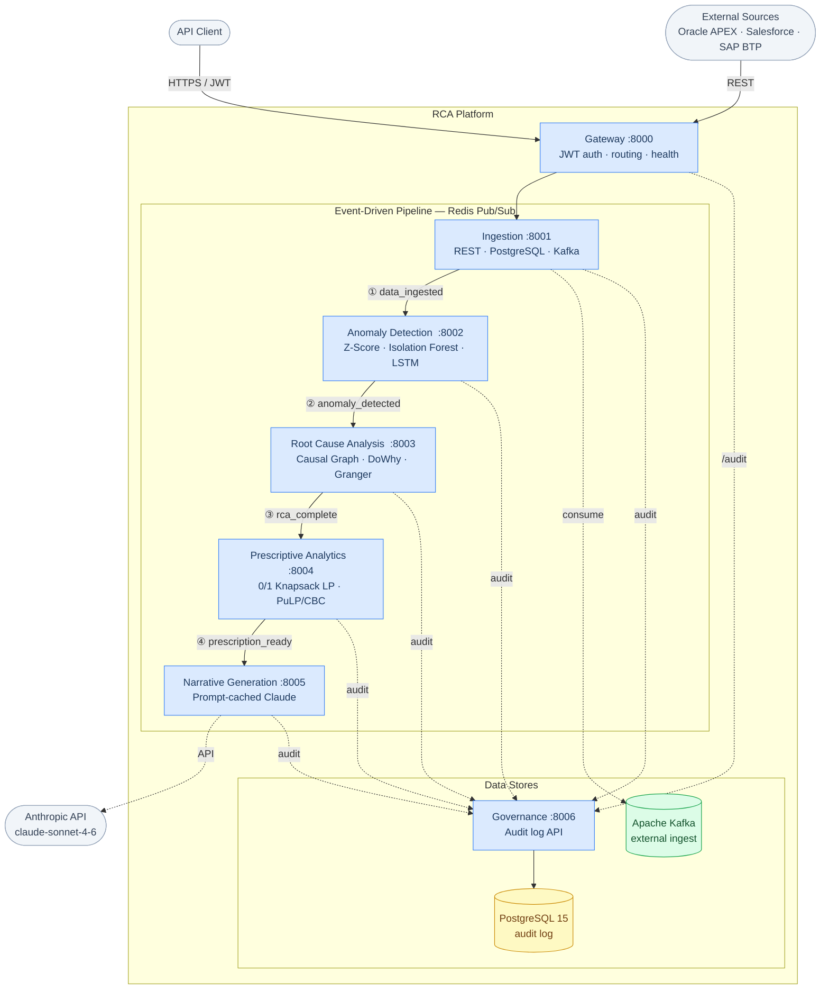

# RCA Platform

An end-to-end, event-driven microservices platform that automatically detects anomalies in operational data, identifies their root causes using causal inference, prescribes prioritised remediation actions, and delivers the findings as plain-English business narratives via Claude AI.

---

## Table of Contents

- [Overview](#overview)
- [Architecture](#architecture)
- [Services](#services)
- [Getting Started](#getting-started)
- [Experiment Results](#experiment-results)
- [Configuration](#configuration)

---

## Overview

Most observability tools tell you *that* something went wrong. This platform tells you *why* — and then tells you *what to do about it*, in a language your operations team can act on.

The pipeline runs in five stages, each as an independent microservice communicating over Redis pub/sub:

```
Ingest → Detect Anomalies → Root Cause Analysis → Prescribe Actions → Generate Narrative
```

Each stage can be triggered via the unified API gateway, or fired independently for targeted use. Every event is persisted to an audit log in Postgres for traceability.

---

## Architecture



---

## Services

### Gateway (`services/gateway`)
Single entry point for all external traffic. Handles JWT authentication, routes requests to the appropriate downstream service, and exposes a `/health` endpoint that aggregates the health of all six backend services.

### Ingestion (`services/ingestion`)
Pulls raw data from three source types:
- **PostgreSQL** — SQL query over a configured connection string
- **REST API** — HTTP GET with configurable headers
- **Kafka** — topic consumer with configurable offset

Normalises all data into a common row format and publishes the `data_ingested` event.

### Anomaly Detection (`services/anomaly`)
Three interchangeable detectors, selectable per request:

| Detector | Method | Best for |
|---|---|---|
| **Z-Score** | Flags rows where any numeric feature exceeds ±N standard deviations | Fast, interpretable, real-time alerting |
| **Isolation Forest** | Ensemble of random trees; short average path = anomaly | Multivariate, no distribution assumptions |
| **LSTM Autoencoder** | Trains on sequences, flags high reconstruction error | Temporal patterns, gradual drift |

The service defaults to Isolation Forest for event-driven processing, and exposes all three via the `/detect` endpoint.

### Root Cause Analysis (`services/rca`)
Runs three complementary causal analyses and merges results by confidence, deduplicating by feature:

1. **Causal Graph** — builds a DAG from correlation structure (Pearson ≥ 0.3, variance-directed edges, cycle prevention via NetworkX)
2. **DoWhy** — estimates causal effects using backdoor linear regression on the DAG; falls back to Pearson correlation when DoWhy is unavailable
3. **Granger Causality** — pairwise chi-squared tests (statsmodels) to find features with statistically significant lagged predictive power (p < 0.05)

Effect sizes are weighted by the delta between the fault window and the normal baseline, so variables that causally matter *and* actually changed during the fault rank highest.

### Prescriptive Analytics (`services/prescriptive`)
Frames intervention selection as a **0/1 knapsack problem** solved with PuLP/CBC:

- **Objective:** maximise `Σ(effect_size × confidence)` across selected actions
- **Constraint:** normalised resource cost stays within a configurable budget fraction
- Falls back to top-3 by effect size if the LP finds no feasible solution

### Narrative Generation (`services/narrative`)
Calls the Anthropic API (claude-sonnet-4-6) with the full pipeline output and generates:
- An executive summary (2–3 sentences)
- A root cause explanation in business terms
- 3–5 prioritised, actionable recommendations

Uses **prompt caching** on the system prompt to reduce latency and token cost on repeated calls.

### Governance (`services/governance`)
Persists every pipeline event to Postgres as a structured audit record. Queryable by `trace_id`, `service`, or time range via the gateway's `/audit` endpoint.

---

## Getting Started

### Prerequisites

- Docker and Docker Compose
- An Anthropic API key (for the narrative service)

### 1. Clone and configure

```bash
git clone https://github.com/Baibhab23/rca-platform.git
cd rca-platform
cp .env.example .env
# Edit .env and add your ANTHROPIC_API_KEY
```

### 2. Start all services

```bash
./start.sh
# or: docker compose up --build
```

This starts Postgres, Redis, Kafka/Zookeeper, and all seven application services.

### Run experiments locally (no Docker needed)

```bash
pip install -r requirements.txt
python experiments/run_experiments.py
# Results written to experiments/outputs/
```

---

## Experiment Results

Validated on 200 rows of simulated manufacturing sensor data. A fault was injected at rows 45–55: temperature spiked +20 °C, pressure dropped –30 bar, and output quality fell 25 units.

### Anomaly Detection

| Detector | Anomalies flagged | Precision on fault rows |
|---|---|---|
| Z-Score (3σ threshold) | 11 | 100% |
| Isolation Forest (5% contamination) | 10 | 100% |
| LSTM Autoencoder | 8 | 62% |

Z-Score and Isolation Forest achieved perfect precision with zero false positives. The LSTM detected the fault peak but lagged on onset by ~6 rows and generated 3 false positives past the window edge.

### Root Cause Analysis

| Feature | Effect size | Confidence | Method |
|---|---|---|---|
| Temperature | 17.241 | 0.945 | correlation |
| Pressure | 5.632 | 0.849 | correlation |
| Vibration | 0.396 | 0.284 | correlation |
| Flow rate | 0.033 | 0.032 | correlation |

Temperature and pressure are the genuine fault drivers. The Granger test found no significant lagged predictors (p > 0.05 for all pairs), confirming this was a sudden spike rather than a slowly building trend.

### Prescriptive Actions (60% resource budget)

The LP optimiser selected the two highest-impact interventions:
1. **Temperature** — inspect cooling elements, PID tuning, thermocouple calibration
2. **Pressure** — check pressure regulator, upstream lines, set a ±10 bar real-time alert

---

## Configuration

Copy `.env.example` to `.env` and set the following:

| Variable | Description |
|---|---|
| `ANTHROPIC_API_KEY` | Required — Anthropic API key for the narrative service |
| `JWT_SECRET` | Secret for signing auth tokens (change before deploying) |
| `DATABASE_URL` | Postgres connection string |
| `REDIS_URL` | Redis connection string |
| `KAFKA_BOOTSTRAP_SERVERS` | Kafka broker address |

Service URLs (`INGESTION_URL`, `ANOMALY_URL`, etc.) default to the Docker Compose service names and only need overriding when running services outside Docker.
